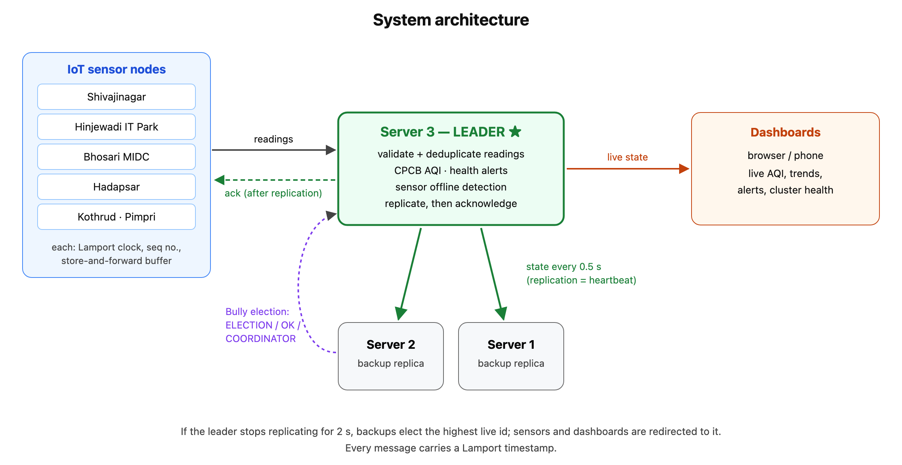
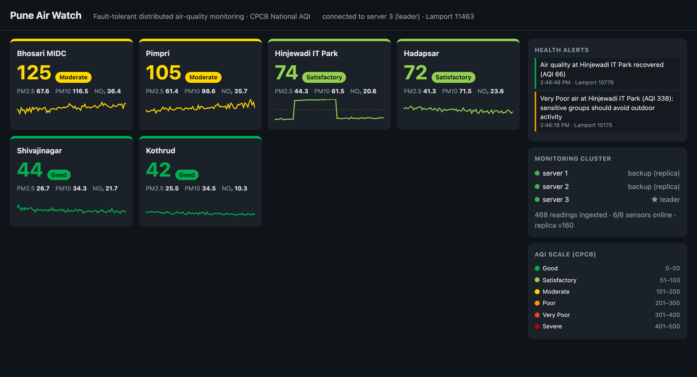
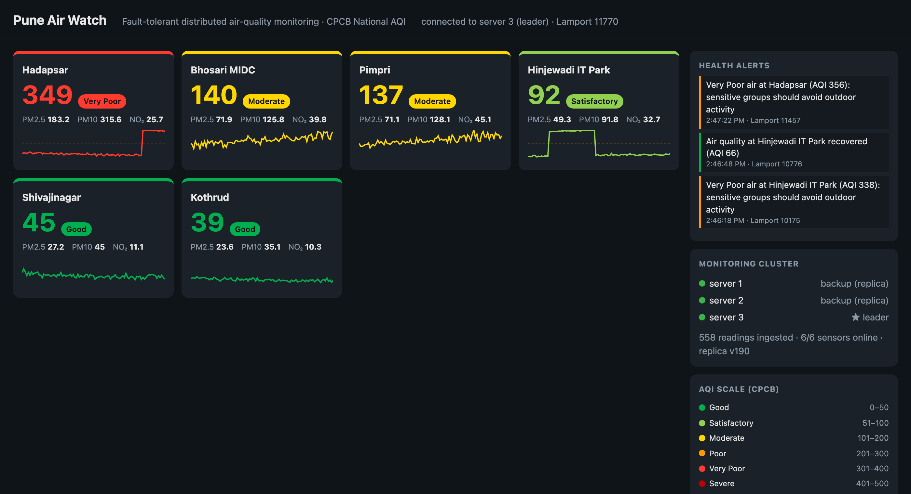
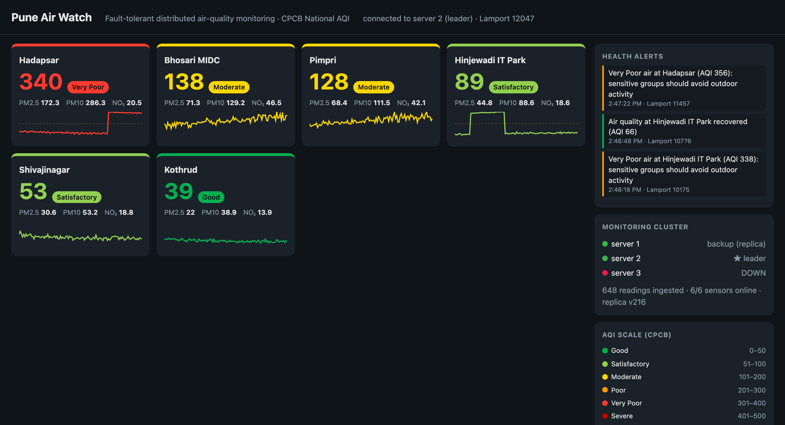
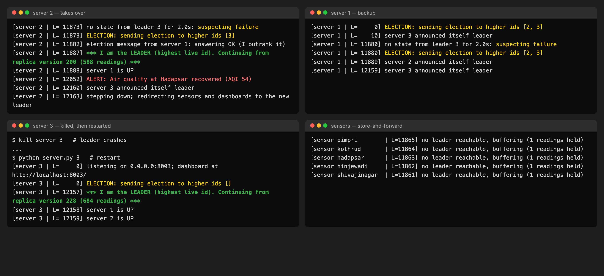
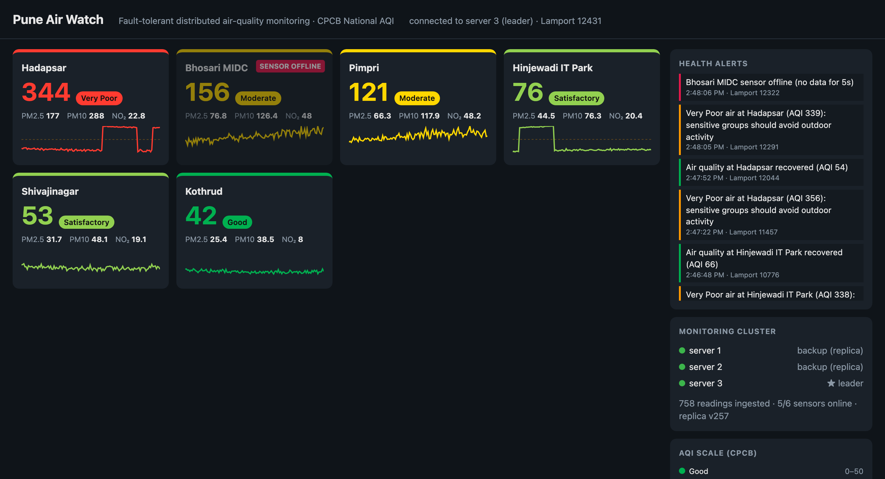
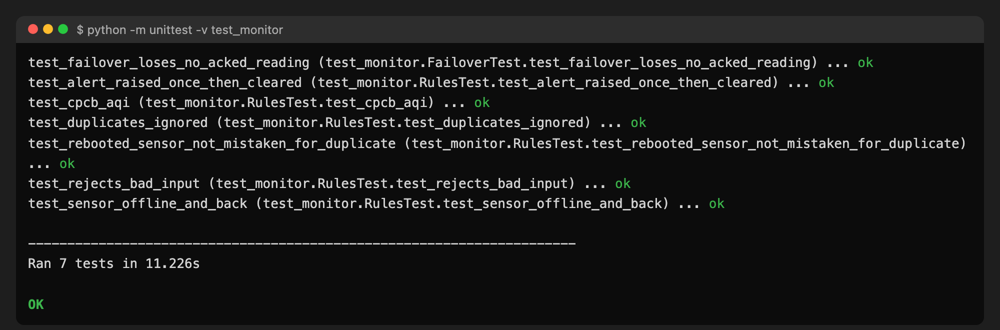

<h1>Fault-Tolerant Distributed Air-Quality Monitoring System using Bully Election and Lamport Clocks</h1>

<b>Mini Project Report — Distributed Computing System Laboratory (BIT27PC04)</b> 
Final Year B.Tech Information Technology, Semester VII, PCCoE Pune — 2026–27

<table border="1" cellpadding="4">
<tr><td><b>Student name</b></td><td>[Your Name]</td></tr>
<tr><td><b>PRN</b></td><td>[Your PRN]</td></tr>
<tr><td><b>Division / Roll no.</b></td><td>[Div / Roll]</td></tr>
<tr><td><b>Guide</b></td><td>[Guide Name]</td></tr>
<tr><td><b>GitHub</b></td><td>https://github.com/VaradRane12/distributed-air-quality-monitoring</td></tr>
</table>

<h2>Abstract</h2>

This project builds a distributed IoT network that monitors air quality across six locations in Pune. Sensor nodes stream PM2.5, PM10 and NO2 readings to a cluster of three monitoring servers. One server, the leader, computes the official CPCB Air Quality Index (AQI), raises health alerts, and replicates its state to the other two servers every half second. If the leader crashes, the remaining servers detect the silence and elect a new leader using the Bully algorithm. The new leader continues from its replica, so monitoring resumes without manual intervention. Sensors keep every reading until the leader confirms it has been replicated, and they re-send unconfirmed readings after a failover. Each reading carries a sequence number, so the server can discard duplicates. Every message carries a Lamport logical timestamp, which gives all events a consistent order without synchronised clocks. In automated tests and live runs, the system recovered from a leader crash in about 2.5 seconds with no readings lost and none counted twice.

<h2>1. Introduction</h2>

Air pollution is one of the largest environmental health risks in Indian cities. Fine particles (PM2.5) reach deep into the lungs and the bloodstream, and long exposure is linked to asthma, heart disease and lung cancer. People can reduce their exposure, for example by staying indoors or avoiding heavy traffic, but only if they are warned in time. A city-wide monitoring network therefore has to keep running continuously, because its value lies in raising warnings at the moment the air turns bad.

Such a network is distributed by nature. Sensors are spread across the city, data has to travel over a network to the servers that analyse it, and the results must reach many users at once. The simplest design sends everything to one central server, but that server is a single point of failure: if it crashes, every sensor's data is lost and no alerts are raised, however many sensors are still working. This project applies the core techniques of distributed computing to remove that single point of failure. The service is spread over several cooperating servers that agree on a leader, share their state, and take over from each other automatically when one fails.

The project implements item 9 of the syllabus's suggested mini projects, an IoT-based distributed sensor monitoring system, and extends it with leader election, replication and fault tolerance.

<h2>2. Problem Statement and Objectives</h2>

The aim is a monitoring service that keeps collecting data and raising alerts when any server crashes, including the one in charge, without losing readings or counting them twice. The objectives are:

<ol>
<li>Implement sensor nodes and monitoring servers that communicate by message passing over WebSocket (TCP).</li>
<li>Compute the CPCB AQI for each station and raise and clear health alerts in real time.</li>
<li>Elect a coordinator among the servers with the Bully algorithm, and elect a new one automatically after a failure.</li>
<li>Replicate the leader's state to backup servers so that a new leader can continue where the old one stopped.</li>
<li>Guarantee that no confirmed reading is lost and none is counted twice.</li>
<li>Detect failed servers and failed sensors, and order all events with Lamport logical clocks.</li>
</ol>

<h2>3. Theoretical Background</h2>

<h3>3.1 Distributed systems and IoT</h3>

Tanenbaum and van Steen define a distributed system as a collection of independent computers that appears to its users as a single coherent system. The computers share no memory and no common clock, so they cooperate only by exchanging messages, and any of them can fail independently of the others. A system built on these assumptions has to answer three questions: how its parts communicate, how they coordinate (for example, who is in charge and in what order events happened), and how the system keeps working when some parts fail. Internet-of-Things (IoT) systems are a form of pervasive distributed system in which many small devices, here air-quality sensors, continuously send data from the physical world to servers for analysis.

<h3>3.2 Client-server and primary-backup architecture</h3>

In the client-server model, clients send requests or data to a server that does the processing. Here the sensors and dashboards are clients and the monitoring servers are servers. To make the server side fault tolerant, this project uses the <b>primary-backup</b> (passive replication) model. Exactly one replica, the primary or leader, handles all client requests. It sends its updated state to the backups, which do nothing but store it. When the primary fails, one backup is promoted and continues from the stored state. Primary-backup is simpler than active replication, where every replica processes every request, because only one replica makes decisions and the replicas cannot disagree.

<h3>3.3 Message-oriented communication</h3>

All components communicate by exchanging messages, without shared memory or remote procedure calls. Each message is a small JSON document carried over a WebSocket, a persistent, two-way connection running on top of TCP. TCP guarantees that the messages on one connection arrive in order and without corruption. It does not guarantee that a message is delivered if the receiver crashes, so the application has to handle reliability itself (section 3.7).

<h3>3.4 Logical clocks: Lamport timestamps</h3>

Computers in a distributed system cannot rely on their physical clocks to order events, because clocks drift and are never perfectly synchronised. Lamport (1978) observed that what matters is the <i>happened-before</i> relation: event a happened before event b if they occur in the same process in that order, or if a is the sending of a message and b is its receipt. Each process keeps a counter C and follows two rules:

<ol>
<li>Before each local event or message send, increment the counter: C = C + 1. Attach C to every message sent.</li>
<li>On receiving a message with timestamp t, set C = max(C, t) + 1.</li>
</ol>

These rules guarantee that if a happened before b, then C(a) &lt; C(b). In this project every sensor, server and dashboard keeps a Lamport clock. Every reading, server message and alert carries a timestamp, so events from different machines can be placed in an order consistent with causality.

<h3>3.5 Leader election: the Bully algorithm</h3>

Many distributed algorithms need one process to act as coordinator. When the coordinator fails, the others must agree on a replacement. In the Bully algorithm (Garcia-Molina, 1982), every process has a unique id, and the live process with the highest id always becomes the coordinator. A process P that notices the coordinator is gone starts an election:

<ol>
<li>P sends an ELECTION message to every process with a higher id.</li>
<li>If none of them answers, P has the highest live id. It becomes coordinator and sends a COORDINATOR message to all processes.</li>
<li>If a higher process answers OK, it takes over the election, and P waits for the COORDINATOR message. If none arrives in time, P starts again.</li>
</ol>

A process that recovers after a crash immediately holds an election. If it has the highest id, it "bullies" its way back to being coordinator, which gives the algorithm its name. The algorithm assumes that failures are crashes, that messages arrive within a known time, and that every process can reach every other. In the worst case it sends O(n²) messages, which is negligible for a small cluster such as the three servers used here.

<h3>3.6 Failure detection</h3>

Over a network, a crashed process looks the same as a very slow one: it simply stops responding. The usual practical solution is heartbeats with a timeout. A process sends a periodic "I am alive" message, and the others suspect it has failed when no heartbeat arrives within the timeout. A short timeout detects failures quickly but risks false alarms when the network is slow, and a long timeout does the reverse. In this project the leader's replication messages, sent every 0.5 s, double as heartbeats, and backups suspect the leader after 2 s of silence. The same idea applies to sensors: a station that sends nothing for 5 s is reported offline.

<h3>3.7 Reliable delivery: at-least-once with deduplication</h3>

When a server can crash at any moment, a sender cannot tell whether a message it sent just before the crash was processed. Re-sending it may cause duplicates, and not re-sending it may lose data. The standard answer has two parts. The sender keeps each message until it receives an acknowledgement and re-sends anything unacknowledged after reconnecting (<i>store-and-forward</i>, giving <i>at-least-once</i> delivery). The receiver gives each sender's messages increasing sequence numbers and ignores any message whose number it has already seen, which makes processing <i>idempotent</i>. Together these make delivery effectively <i>exactly-once</i>.

<h3>3.8 Replication and consistency</h3>

Replication keeps copies of data on several machines so that the data survives the loss of one. Replication can be synchronous, where the primary waits for backups before replying, or asynchronous, where it replies immediately and copies later. Synchronous replication is safer, and asynchronous replication is faster. This project uses a middle path called <b>replicate-then-acknowledge</b>. The leader replicates in rounds every 0.5 s, and it acknowledges a sensor's reading only after the round containing that reading has been sent to the backups. A sensor drops a reading from its buffer only on acknowledgement, so any reading the leader had not yet replicated when it crashed is still in the sensor's buffer and is sent again. Backups accept a new state only if its version number is higher than the one they hold, so an old or delayed message can never overwrite newer data.

<h3>3.9 Air Quality Index (CPCB)</h3>

India's National Air Quality Index, published by the Central Pollution Control Board, turns pollutant concentrations into one number from 0 to 500 with six categories: Good (0–50), Satisfactory (51–100), Moderate (101–200), Poor (201–300), Very Poor (301–400) and Severe (401–500). For each pollutant, the concentration C is mapped to a sub-index by linear interpolation between the breakpoints (C_lo, C_hi) of its band, which correspond to the index values (I_lo, I_hi):

<b>I = I_lo + (I_hi − I_lo) × (C − C_lo) / (C_hi − C_lo)</b>

The AQI is the highest of the pollutants' sub-indices, so the worst pollutant decides the category. This project raises a health alert when a station reaches Poor (AQI 201) and clears it only when the AQI falls below 180. The gap between the two thresholds (hysteresis) stops the alert from flickering on and off when the value hovers near the threshold.

<h2>4. System Architecture</h2>

<i>Figure 1: System architecture.</i>

The system has three kinds of components. <b>Sensor nodes</b> (sensors.py) simulate monitoring stations at Shivajinagar, Hinjewadi, Bhosari MIDC, Hadapsar, Kothrud and Pimpri. Each one measures once per second whether or not a server is reachable. It keeps its own connection, Lamport clock, sequence counter and buffer of unacknowledged readings. <b>Monitoring servers</b> (server.py) all run the same program, and each can act as leader or backup. The leader validates each reading, discards duplicates, computes the AQI, manages alerts, flags silent sensors, replicates its state and pushes live updates to dashboards. Backups store the replica and run the election if the leader goes quiet. The <b>dashboard</b> (index.html) is a web page that shows each station's AQI, colour-coded by category, with a trend chart, an alert feed and the status of each server. It runs in any browser, including on a phone. Sensors and dashboards may connect to any server: a backup simply redirects them to the current leader, and they reconnect by themselves after a failover.

<h2>5. Working of the System</h2>

<b>Normal operation.</b> On start-up the servers hold a Bully election and server 3, the highest id, becomes leader. Each sensor sends a reading every second, stamped with its station id, sequence number and Lamport time. Every 0.5 s the leader increases its state version and sends the full state to both backups. It then acknowledges the newest reading from each sensor and pushes the update to all dashboards.

<b>When the leader fails.</b> The backups stop receiving state messages, and after 2 s each one suspects the leader and starts an election. Server 1 sends ELECTION to servers 2 and 3. Server 2 answers OK and starts its own election, sending ELECTION to server 3. When server 3 does not answer, server 2 asks the other servers for their replicas, adopts the newest, and announces itself with COORDINATOR. During this time the sensors cannot reach a leader, so they keep measuring and buffering. When they reconnect, a backup redirects them to server 2, and they re-send everything not yet acknowledged. Server 2 discards the duplicates and accepts the rest, so the trend charts show no gap.

<b>Recovery.</b> When server 3 is restarted, it holds an election, finds no higher id, takes the newest replica from the other servers, and becomes leader again. The old leader steps down and redirects its clients. If a sensor stops reporting, the leader marks it offline after 5 s and raises a warning; when the sensor returns, it is marked back online.

<h2>6. Implementation</h2>

The servers and sensors are written in Python 3 using asyncio and the websockets library. The dashboard is a single HTML page with JavaScript and canvas-drawn trend charts. All messages are JSON. Sensor data is simulated from typical pollution levels for each area, with a daily cycle, random noise and occasional pollution events such as a garbage fire. Typing a station's name in the sensor terminal triggers such an event on demand. Every reading is validated before it touches the server's state, so malformed values (negative, non-numeric or impossibly large) are rejected. The project has seven automated tests written with Python's unittest. Six check the rules: AQI values, duplicate handling, rebooted sensors, alert raising and clearing, offline detection and input validation. The seventh starts a real three-server cluster, kills the leader, and checks that every reading is counted exactly once.

<h2>7. Results</h2>

<i>Figure 2: Live dashboard during normal operation. Server 3 leads; servers 1 and 2 are backups.</i>

<i>Figure 3: A pollution event at Hadapsar pushes the AQI into Very Poor and a health alert is raised.</i>

To test fault tolerance, the leader (server 3) was killed while all six sensors were streaming. Servers 1 and 2 detected the failure after 2 s, server 2 won the election, and it continued from replica version 200, which held 588 readings. The dashboard switched to server 2 by itself. The health alert raised just before the crash was neither lost nor repeated.

<i>Figure 4: After the leader crash. Server 2 has taken over and server 3 is shown DOWN.</i>

<i>Figure 5: Server and sensor logs during the failover and the Bully election.</i>

Server 3 was then restarted. It won the election again and took over the replicated data (684 readings by then). Finally, the Bhosari sensor was stopped, and the dashboard marked it offline within 5 seconds.

<i>Figure 6: Server 3 leads again after restarting; the Bhosari sensor is detected as offline.</i>

<i>Figure 7: All seven automated tests pass.</i>

<table border="1" cellpadding="4">
<tr><th>Measure</th><th>Result</th></tr>
<tr><td>Leader failure detection</td><td>2.0 s</td></tr>
<tr><td>Total failover time</td><td>about 2.5 s</td></tr>
<tr><td>Confirmed readings lost / duplicates counted</td><td>0 / 0</td></tr>
<tr><td>Sensor failure detection</td><td>5 s</td></tr>
</table>

<h2>8. Advantages of the Design</h2>

In a conventional single-server design, a server crash stops all monitoring until someone restarts it by hand. Readings sent in the meantime are lost, and any data that was not backed up has to be restored manually. In this system the same crash is handled in about 2.5 seconds, with no human involvement. A new leader is elected, it already holds the data, and the sensors fill any gap from their buffers. The design therefore has no single point of failure: any one server, including the leader, can fail without stopping the service.

The system is also correct as well as available. Because readings are acknowledged only after replication, and duplicates are dropped by sequence number, every reading is counted exactly once, even when it had to be sent twice. Because alert state is replicated along with the data, alerts are neither lost nor repeated during a failover. Lamport timestamps give every event a consistent order without relying on synchronised clocks. Failed sensors are detected as well as failed servers, so a silent station is reported instead of quietly showing old values.

These benefits come with deliberate trade-offs. The Bully algorithm is much simpler than consensus protocols such as Raft or Paxos, but it assumes crash failures and does not handle a network split into two halves. Sending the full state every round is easy to reason about and makes recovery immediate, but it suits tens of stations rather than thousands. For a city monitoring network of this size, these choices keep the system small, understandable and testable.

<h2>9. SDG Mapping</h2>
<table border="1" cellpadding="4">
<tr><th>SDG</th><th>Target</th><th>Contribution</th></tr>
<tr><td>SDG 3 – Good Health and Well-being</td><td>3.9 reduce illness and deaths from air pollution</td><td>Real-time AQI and health alerts warn residents to avoid exposure</td></tr>
<tr><td>SDG 11 – Sustainable Cities and Communities</td><td>11.6 reduce cities' environmental impact, especially air quality</td><td>City-wide monitoring pinpoints pollution hotspots for action</td></tr>
<tr><td>SDG 13 – Climate Action</td><td>13.3 climate awareness and capacity</td><td>Continuous public pollution data supports awareness and policy</td></tr>
<tr><td>SDG 9 – Industry, Innovation and Infrastructure</td><td>9.1 reliable, resilient infrastructure</td><td>Fault-tolerant design keeps a public-health service running</td></tr>
</table>

<h2>10. Conclusion and Future Scope</h2>

The project shows how the main ideas of distributed computing work together in a real application. Message passing connects the sensors, servers and dashboards. Lamport clocks order events without synchronised time. The Bully algorithm elects a coordinator. Primary-backup replication, with replicate-then-acknowledge and sequence-number deduplication, keeps the data safe and exact. The result is an air-quality warning service that recovers from a leader crash in about 2.5 seconds with no readings lost or duplicated, which directly supports SDG 3.9 and SDG 11.6.

Future work could connect real sensor hardware, such as an ESP32 board with a PMS5003 particulate sensor. It could also replace the Bully algorithm with Raft to tolerate network partitions, store long-term history to compute the official 24-hour average AQI, and send SMS alerts to schools and residents near a pollution hotspot.

<h2>References</h2>
<ol>
<li>M. van Steen and A. S. Tanenbaum, Distributed Systems, 3rd ed., 2017.</li>
<li>G. Coulouris, J. Dollimore, T. Kindberg and G. Blair, Distributed Systems: Concepts and Design, 5th ed., Addison-Wesley, 2012.</li>
<li>L. Lamport, "Time, Clocks, and the Ordering of Events in a Distributed System," Communications of the ACM, 21(7), 1978.</li>
<li>H. Garcia-Molina, "Elections in a Distributed Computing System," IEEE Transactions on Computers, C-31(1), 1982.</li>
<li>Central Pollution Control Board, National Air Quality Index, Government of India, 2014.</li>
<li>World Health Organization, WHO Global Air Quality Guidelines, 2021.</li>
</ol>
