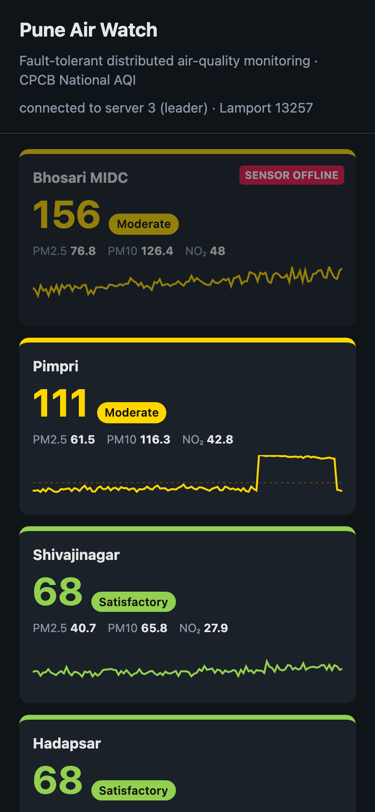

# Pune Air Watch: A Fault-Tolerant Distributed Air-Quality Monitoring Network

**Mini Project Report — Distributed Computing System Laboratory (BIT27PC04)**

Final Year B.Tech Information Technology, Semester VII
Pimpri Chinchwad College of Engineering (PCCoE), Pune — Academic Year 2026–27

| Field | Details |
|---|---|
| Student name | [Your Name] |
| PRN | [Your PRN] |
| Division / Roll no. | [Div / Roll] |
| Guide | [Guide Name] |
| GitHub repository | https://github.com/VaradRane12/distributed-air-quality-monitoring |

---

## Abstract

Air pollution is among the largest environmental health risks in Indian cities, and people can only protect themselves if they are warned in time. A warning system that goes silent whenever one server fails is not good enough. This project builds Pune Air Watch, a distributed IoT air-quality monitoring network. Sensor nodes at six Pune locations stream PM2.5, PM10 and NO2 readings to a cluster of monitoring servers. The leader server computes the official CPCB National Air Quality Index (AQI), raises health alerts when air quality becomes Poor or worse, detects sensors that stop reporting, and replicates its state to backup servers every half second. The replication stream doubles as a heartbeat: when it stops, the backups detect the failure and elect a new leader with the Bully algorithm, which continues from its replica. Sensors keep unacknowledged readings in a store-and-forward buffer and re-send them after failover; per-sensor sequence numbers let the server drop duplicates, and the leader acknowledges a reading only after replicating it. Together these guarantee that no acknowledged reading is lost and none is counted twice. All messages carry Lamport logical timestamps. A live web dashboard shows each station's AQI, trends, alerts and the cluster's health. Automated tests and live runs kill the leader mid-stream and confirm that monitoring resumes in about 2.5 seconds with no data lost.

**Keywords:** distributed systems, IoT, air quality, CPCB AQI, Bully election, Lamport clock, primary-backup replication, fault tolerance, store-and-forward, SDG 3, SDG 11.

---

## 1. Introduction

Fine particulate matter (PM2.5), coarse particles (PM10) and nitrogen dioxide (NO2) cause respiratory and cardiovascular disease, and Indian cities regularly exceed safe limits. India's Central Pollution Control Board (CPCB) publishes a National Air Quality Index that turns pollutant concentrations into a single number from 0 to 500 with six health categories, from Good to Severe.

A city-wide monitoring network is naturally distributed: sensors are spread across the city, and data must be collected, analysed and published continuously. If the central server is a single machine, its failure blinds the whole network exactly when an alert might be needed. This project applies the distributed-systems techniques from the syllabus — message passing, logical clocks, leader election, replication, failure detection and recovery — so that the monitoring service keeps working through server crashes.

The project implements item 9 of the syllabus's suggested mini projects: an IoT-based distributed sensor monitoring system, in which multiple sensor nodes send data to a central monitoring service for analysis.

## 2. Problem Statement

Design and implement a distributed air-quality monitoring system in which:

1. Multiple sensor nodes across the city report pollutant readings continuously.
2. A monitoring service computes the CPCB AQI per station and raises health alerts in real time.
3. The monitoring service survives the crash of any server, including the one currently in charge, without losing acknowledged readings or double-counting re-sent ones.
4. Failed sensors are detected and reported.

## 3. Objectives

1. Build sensor nodes and monitoring servers that communicate by WebSocket (TCP) message passing.
2. Compute the CPCB National AQI and raise and clear health alerts with hysteresis.
3. Elect a coordinator among the monitoring servers with the Bully algorithm.
4. Replicate the monitoring state from the leader to backup servers (primary-backup).
5. Guarantee no loss of acknowledged readings (replicate-then-acknowledge) and no double counting (store-and-forward with sequence-number deduplication).
6. Detect failures of servers (heartbeats) and of sensors (offline timeout).
7. Timestamp all messages and alerts with Lamport logical clocks.
8. Verify fault tolerance with automated tests and live failure experiments.

## 4. Scope

- **In scope:** crash failures of monitoring servers and sensors; any number of servers (configured in cluster.json, demonstrated with 3); six simulated Pune stations; live dashboard on any browser on the network, including phones.
- **Out of scope:** physical sensor hardware (sensor data is simulated with realistic baselines, a daily cycle and random pollution events); network partitions; long-term storage; 24-hour averaging as in the official CPCB method.

## 5. Background

### 5.1 CPCB National Air Quality Index

For each pollutant, the concentration is mapped to a sub-index by linear interpolation between breakpoints. The AQI is the highest sub-index.

| AQI | Category | PM2.5 (µg/m³) | PM10 (µg/m³) | NO2 (µg/m³) | Health impact |
|---|---|---|---|---|---|
| 0–50 | Good | 0–30 | 0–50 | 0–40 | Minimal |
| 51–100 | Satisfactory | 31–60 | 51–100 | 41–80 | Minor discomfort to sensitive people |
| 101–200 | Moderate | 61–90 | 101–250 | 81–180 | Breathing discomfort for people with lung or heart disease |
| 201–300 | Poor | 91–120 | 251–350 | 181–280 | Breathing discomfort for most people on prolonged exposure |
| 301–400 | Very Poor | 121–250 | 351–430 | 281–400 | Respiratory illness on prolonged exposure |
| 401–500 | Severe | 250+ | 430+ | 400+ | Affects healthy people; serious impact on the sick |

Sub-index formula: I = I_lo + (I_hi − I_lo) × (C − C_lo) / (C_hi − C_lo)

### 5.2 Distributed-systems concepts

| Concept | Description | Syllabus |
|---|---|---|
| Pervasive / IoT systems; client-server and primary-backup architecture | Sensors are clients; one primary server serves them while backups stand by | Unit 1 |
| Message-oriented communication | JSON messages over persistent WebSocket (TCP) connections | Unit 2 |
| Lamport logical clocks | Counter incremented on every event; on receive, clock = max(local, received) + 1. Orders events consistently without synchronised physical clocks | Unit 2 |
| Bully election | A process that suspects the coordinator sends ELECTION to higher ids; if none answers it becomes coordinator, otherwise it waits for COORDINATOR. The highest live id wins | Unit 2 |
| Store-and-forward, at-least-once delivery | Sender keeps a message until it is acknowledged and re-sends it after a failure; the receiver drops duplicates by sequence number | Unit 2 |
| Primary-backup replication | The primary pushes its state to backups; backups accept only newer versions | Unit 4 |
| Failure detection and recovery | Heartbeat timeouts detect crashed servers; the new leader recovers from the freshest replica | Unit 4 |
| Web-based distributed systems | Dashboard served over HTTP; backups redirect clients to the leader | Unit 3 |

## 6. System Architecture


*Figure 1: System architecture. Sensors send readings to the leader, which replicates its state to two backups before acknowledging. Backups elect a new leader if the replication stream stops.*

### 6.1 Components

- **Sensor node (sensors.py):** one independent client per station, each with its own connection, Lamport clock, boot id, sequence counter and store-and-forward buffer. It measures once per second whether or not a server is reachable. For the demo, typing a station id simulates a pollution event such as a garbage fire.
- **Monitoring server (server.py):** every server runs the same program; any one can be leader or backup. The leader validates and ingests readings, computes the AQI, manages alerts, detects offline sensors, replicates its state and pushes live updates to dashboards. Backups keep the replica and watch for leader failure.
- **Dashboard (static/index.html):** colour-coded AQI card per station (sorted worst first) with PM2.5, PM10 and NO2 values and a trend chart, a health-alert feed, and a panel showing which servers are up and which one leads. It fails over to another server automatically.
- **Configuration (cluster.json):** the id and address of every server.

### 6.2 Message Types

| Message | From → To | Purpose |
|---|---|---|
| reading | sensor → leader | Pollutant values with station id, boot id, sequence number and Lamport ts |
| ack | leader → sensor | Highest sequence number now safely replicated |
| state | leader → backups | Full monitoring state every 0.5 s (replication + heartbeat) |
| election / ok | lower id → higher id | Bully election probe and its answer |
| coordinator | new leader → all | Announces the new leader |
| get_state | new leader → all | Fetch replicas; adopt the highest version |
| watch / state | dashboard ↔ leader | Subscribe; receive live updates |
| redirect | backup → sensor or dashboard | Points the client at the current leader |

## 7. Algorithms

### 7.1 Lamport Logical Clock

```
on local event or send:   clock = clock + 1; attach clock to message
on receive(ts):           clock = max(clock, ts) + 1
```

Every reading, server message and alert carries its Lamport timestamp; the dashboard shows it next to each alert.

### 7.2 Bully Election

```
start_election():
    leader = none
    send ELECTION to every server with a higher id
    if nobody answers OK:  become_leader()
    else: wait for COORDINATOR; if none arrives in time, retry

on ELECTION from a lower id:  reply OK; start my own election
on COORDINATOR(id):           if id < my id: start election   else: leader = id

become_leader():
    ask every server for its replica; adopt the highest version
    announce COORDINATOR to everyone; start the leader loop
```

### 7.3 Replicate-then-Acknowledge (leader loop, every 0.5 s)

```
mark sensors with no reading for 5 s as OFFLINE (alert)
version = version + 1
send STATE to every backup and wait for the sends to complete
send ACK(highest seq received) to each sensor
push the state to every dashboard
```

A sensor drops a reading from its buffer only on ACK, and ACK is sent only after the reading has been replicated. A leader crash therefore loses only unacknowledged readings, which the sensor still holds and re-sends.

### 7.4 Ingestion with Deduplication and Alerts

```
ingest(reading):
    if (boot, seq) <= last[station]: ignore (duplicate re-send)
    last[station] = (boot, seq)
    AQI = max sub-index of PM2.5, PM10, NO2
    if AQI >= 201 and station not alerting: raise "Poor air" alert
    if AQI <  180 and station alerting:     raise "recovered" alert   (hysteresis)
```

The boot id changes every time a sensor restarts, so a rebooted sensor whose sequence numbers start again at 1 is not mistaken for a duplicate.

### 7.5 Sensor Store-and-Forward

```
every second: append a new reading (seq + 1) to the buffer
on connect:   re-send every buffered reading, then stream new ones
on ACK(n):    remove readings with seq <= n from the buffer
on redirect:  connect to the named leader; on failure: try the next server
```

## 8. Implementation

| Item | Choice |
|---|---|
| Language | Python 3 (servers, sensors), JavaScript (dashboard) |
| Communication | WebSocket over TCP (websockets library, asyncio) |
| Data format | JSON |
| Dashboard | Single HTML page with canvas trend charts; works on desktop and mobile |
| Testing | Python unittest; a real multi-process cluster for the failover test |
| Code size | about 490 lines of Python (server 357, sensors 131) plus a 134-line dashboard |

**Project structure**

```
server.py           AQI + ingestion rules, replication, Bully election, Lamport clock, HTTP
sensors.py          simulated IoT sensor nodes with store-and-forward buffers
static/index.html   live dashboard
cluster.json        server ids and addresses
test_monitor.py     unit tests + end-to-end failover test
```

**Running**

```
python3 -m venv .venv && .venv/bin/pip install -r requirements.txt
.venv/bin/python server.py 1        # terminals 1-3
.venv/bin/python server.py 2
.venv/bin/python server.py 3
.venv/bin/python sensors.py         # terminal 4
# dashboard: http://localhost:8001/
```

## 9. Results

### 9.1 Normal operation


*Figure 2: Live dashboard. Stations are sorted worst first and coloured by CPCB category. Server 3 is the leader and servers 1 and 2 are backups. The Hinjewadi trend line shows an earlier pollution event, its alert, and its recovery.*

### 9.2 Health alert


*Figure 3: A pollution event at Hadapsar pushes the AQI into Very Poor. The leader raises a health alert, stamped with its Lamport timestamp, advising sensitive groups to avoid outdoor activity.*

### 9.3 Leader crash and failover

The leader (server 3) was killed at 14:47:42 while all six sensors were streaming.


*Figure 4: About 6 seconds after the crash. The dashboard has failed over to server 2, now the leader; server 3 is shown DOWN. The Hadapsar alert raised just before the crash is preserved and not raised twice, and no trend line has a gap.*


*Figure 5: Logs during failover. Servers 1 and 2 detect the missing heartbeat after 2 s and start a Bully election. Server 1 defers to server 2, which becomes leader and continues from replica version 200 (588 readings). Sensors buffer their readings while no leader is reachable. When server 3 restarts, it bullies its way back to leadership and adopts the replicated data (version 228, 684 readings).*

### 9.4 Recovery and sensor failure


*Figure 6: Server 3 has restarted and leads again with all data intact. The Bhosari MIDC sensor process was then stopped; after 5 seconds without data the dashboard marks it SENSOR OFFLINE and raises a warning.*

### 9.5 Mobile view



*Figure 7: The same dashboard on a phone (390 px wide), reachable by any device on the network.*

### 9.6 Automated tests


*Figure 8: All 7 automated tests pass.*

| Test | Checks | Result |
|---|---|---|
| CPCB AQI | Sub-index values at breakpoints; worst pollutant wins; categories | Pass |
| Duplicates ignored | Re-sent readings with old sequence numbers are not counted | Pass |
| Rebooted sensor | A restarted sensor's new readings (seq starting at 1) are accepted; old re-sends still dropped | Pass |
| Alert raise and clear | One alert when AQI crosses 201; one "recovered" message below 180 | Pass |
| Sensor offline | Station flagged after 5 s of silence; "back online" when data resumes | Pass |
| Input validation | Rejects NaN, negative, non-numeric, oversized or missing fields | Pass |
| Leader failover | 3 real servers → readings 1–5 acknowledged → kill leader 3 → server 2 elected → sensor re-sends 4, 5 and new 6 → exactly 6 readings counted → restart server 3 → it leads again with all 7 readings | Pass |

### 9.7 Measured behaviour

| Measure | Result |
|---|---|
| Failure detection time | 2.0 s (heartbeat timeout) |
| Total failover time (crash → new leader serving) | about 2.5 s |
| Readings lost in failover | 0 acknowledged readings (sensors re-sent the unacknowledged ones) |
| Duplicate readings counted | 0 |
| Alerts duplicated by failover | 0 |
| Sensor failure detection | 5 s |
| Replication / dashboard refresh interval | 0.5 s |

## 10. Demonstration Guide: How to Show It Works

The demonstration takes about 8 minutes. It needs four terminals side by side (three servers and the sensors), plus the dashboard in a browser and on a phone.

| Step | Do this | Point at | Concept shown |
|---|---|---|---|
| 1 | Start servers 1, 2, 3 | Logs: ELECTION, then "I am the LEADER" on server 3 | Bully election: highest live id wins |
| 2 | Start the sensors; open the dashboard on a laptop and a phone | Stations fill in; cluster panel shows the leader and 2 backups | IoT client-server, message passing |
| 3 | Open the dashboard via port 8001 (a backup) | It still shows "connected to server 3 (leader)" | Backups redirect clients to the leader |
| 4 | Type kothrud + Enter in the sensors terminal | Kothrud turns Poor or Very Poor; a health alert appears with its Lamport timestamp | CPCB AQI, real-time alerts, Lamport clocks |
| 5 | Press Ctrl+C on server 3 (the leader) | Server 2: "suspecting failure" → ELECTION → "I am the LEADER"; sensors: "buffering"; dashboard switches server, no gap in trend lines, server 3 DOWN | Failure detection, re-election, replication, recovery, store-and-forward |
| 6 | Restart server 3 | It becomes leader again and continues from the replica | Bully on recovery; state transfer |
| 7 | Stop the Bhosari sensor | After 5 s: SENSOR OFFLINE badge and warning | Failure detection for clients |
| 8 | Run the test suite | 7 tests pass, including the automated failover test | Fault tolerance proven repeatably, not just in one demo |

Tip: kill the leader while an alert is active. The audience sees that the alert is neither lost nor repeated.

## 11. Why This Design Is Good

### 11.1 Compared with a single-server monitoring system

| Property | Single central server | Pune Air Watch |
|---|---|---|
| Server crash | Monitoring and alerts stop until someone restarts it | New leader in about 2.5 s, automatically |
| Readings during an outage | Lost | Buffered by sensors and re-sent; none lost |
| Re-sent data | Risk of double counting | Deduplicated by (boot, sequence number) |
| Data on the new server | Must be restored from backup by hand | Already there: replicated every 0.5 s |
| Clients during failover | Must be reconfigured | Redirected automatically |
| Dead sensors | Often unnoticed | Detected in 5 s and reported |

### 11.2 Strengths

1. **No single point of failure.** Any server, including the leader, can crash without stopping monitoring.
2. **No silent data loss.** Replicate-then-acknowledge plus store-and-forward means every reading a sensor was told is safe really is safe.
3. **Exactly-once counting.** Re-sends after failover never inflate the statistics or repeat alerts.
4. **Self-healing.** Detection, election and recovery need no human; a restarted server rejoins on its own.
5. **Consistent ordering without synchronised clocks.** Lamport timestamps order events across machines whose physical clocks may drift.
6. **Uses the official standard.** AQI follows CPCB breakpoints, so the alerts mean what Indian health advisories mean.
7. **Accessible.** Any phone browser on the network can open the dashboard; nothing to install.
8. **Simple and verifiable.** About 490 lines of Python with one dependency, and automated tests that reproduce the failure scenarios.

### 11.3 Design trade-offs

- **Bully instead of Raft:** simpler and well suited to a small, fully connected cluster that sees crash failures; the cost is no protection against network partitions.
- **Full-state replication:** easy to reason about and fast to recover from; it suits tens of stations, not thousands.
- **Asynchronous replication every 0.5 s:** readings become visible quickly. The cost is that acknowledgements wait up to 0.5 s, which sensors absorb in their buffers.

## 12. SDG Mapping

| SDG | Target | Contribution |
|---|---|---|
| SDG 3 – Good Health and Well-being (primary) | 3.9: substantially reduce deaths and illnesses from air pollution | Real-time AQI and health alerts tell residents, especially children, the elderly and people with asthma or heart disease, when to avoid outdoor exposure |
| SDG 11 – Sustainable Cities and Communities | 11.6: reduce the adverse environmental impact of cities, paying special attention to air quality | City-wide network that pinpoints hotspots such as the Bhosari MIDC industrial area, so municipal bodies can act |
| SDG 13 – Climate Action | 13.3: improve awareness and institutional capacity on climate change | Continuous public data on combustion pollutants supports awareness and evidence-based policy |
| SDG 9 – Industry, Innovation and Infrastructure | 9.1: reliable, sustainable and resilient infrastructure | Fault-tolerant design keeps a public-health service running through server failures |

## 13. Course Outcome Mapping (DCS Laboratory)

| Course outcome | How the project addresses it |
|---|---|
| CO1: Implement inter-process communication mechanisms | WebSocket message passing between sensors, servers and dashboards |
| CO2: Analyze synchronization and coordination techniques | Lamport clocks; Bully election; replicate-then-acknowledge |
| CO3: Build distributed applications using web services | HTTP + WebSocket monitoring service consumed by dashboards and sensors |
| CO4: Develop a mini project applying distributed system concepts | Entire project |

## 14. Limitations and Future Scope

**Limitations**

- Sensor readings are simulated; AQI uses instantaneous values instead of CPCB's 24-hour averages.
- The Bully algorithm assumes crash failures; a network partition can briefly create two leaders.
- Sensor buffers are in memory, so a sensor that reboots loses readings it had not yet sent.
- The full state is replicated every round, which suits tens of stations rather than thousands.

**Future scope**

- Real sensor hardware (ESP32 with a PMS5003 particulate sensor), sending the same messages.
- Majority-quorum consensus (Raft) to tolerate network partitions.
- Persistent time-series storage and the official 24-hour averaged AQI.
- SMS or WhatsApp alerts to residents and schools near a hotspot; an open data API for researchers.
- Pollution forecasting from historical data.

## 15. Conclusion

Pune Air Watch shows how distributed-systems techniques make a public-health service dependable. Sensors, servers and dashboards communicate by message passing; Lamport clocks order events; the Bully algorithm elects a coordinator; primary-backup replication with replicate-then-acknowledge and sequence-number deduplication ensures every acknowledged reading is counted exactly once, even when the leader crashes mid-stream. In tests and live runs the network recovered from a leader crash in about 2.5 seconds with no data loss, no duplicated alerts and no gap in monitoring, directly supporting SDG 3.9 and SDG 11.6 on reducing harm from urban air pollution.

## 16. References

1. M. van Steen and A. S. Tanenbaum, Distributed Systems, 3rd ed., 2017.
2. G. Coulouris, J. Dollimore, T. Kindberg and G. Blair, Distributed Systems: Concepts and Design, 5th ed., Addison-Wesley, 2012.
3. L. Lamport, "Time, Clocks, and the Ordering of Events in a Distributed System," Communications of the ACM, 21(7), 1978.
4. H. Garcia-Molina, "Elections in a Distributed Computing System," IEEE Transactions on Computers, C-31(1), 1982.
5. Central Pollution Control Board, National Air Quality Index, Ministry of Environment, Forest and Climate Change, Government of India, 2014.
6. World Health Organization, WHO Global Air Quality Guidelines, 2021.
7. RFC 6455, The WebSocket Protocol, IETF, 2011.
8. United Nations, Sustainable Development Goals, https://sdgs.un.org/goals
